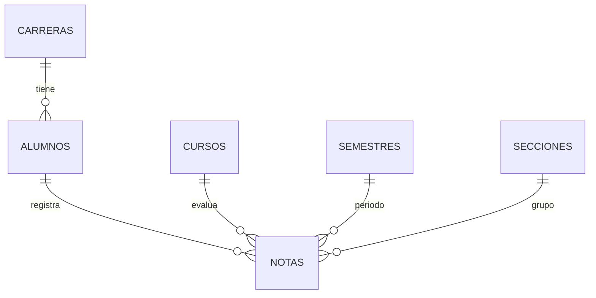

# 03 — Base de datos

**Motor: MySQL/MariaDB.** Phalcon 5 trae adaptadores para MySQL, PostgreSQL y SQLite; **no para SQL Server**. Por eso se cambió de SQL Server Express a MySQL.

## Tablas (definidas en database/schema.sql)
**carreras**: id, nombre (único), created_at
**cursos**: id, nombre (único), created_at
**secciones**: id, nombre (único, ej. A, B, C), created_at
**semestres**: id, nombre (único), created_at
**alumnos**: id, nombres, apellidos, fecha_nacimiento (date), foto (ruta relativa a public/, nullable), carrera_id (FK), created_at
**notas**: id, alumno_id, curso_id, semestre_id, seccion_id (FK), nota DECIMAL(5,2) con CHECK 0–100, created_at
  - UNIQUE (alumno_id, curso_id, semestre_id): un curso por alumno y semestre
  - Aprobado: nota >= 61 (confirmado)
  - Borrar un alumno borra sus notas (CASCADE); no se puede borrar un catálogo en uso (RESTRICT) → el sistema debe mostrar un mensaje, no un error 500

## Relaciones
Carrera 1—N Alumno · Alumno 1—N Nota · Curso/Semestre/Sección 1—N Nota



## Crear y poblar
```bash
mysql -u root -p -e "CREATE DATABASE escuela CHARACTER SET utf8mb4 COLLATE utf8mb4_unicode_ci"
php cli/reset_db.php        # schema.sql + seed.sql
```
Datos de demo: 3 carreras, 8 cursos, 3 secciones, 3 semestres, 10 alumnos y 4 notas por alumno (40 notas entre 61 y 100).

## Pasar datos desde SQL Server (solo si quieren conservar datos propios)
No hace falta para la demo (el seed los recrea). Si se necesitan: en SSMS exportar cada tabla a CSV y en MySQL Workbench usar *Table Data Import Wizard*, respetando el orden: carreras, cursos, secciones, semestres, alumnos, notas.

## Pruebas
Base separada `escuela_test` (ver docs/07). Nunca correr pruebas contra `escuela`.
