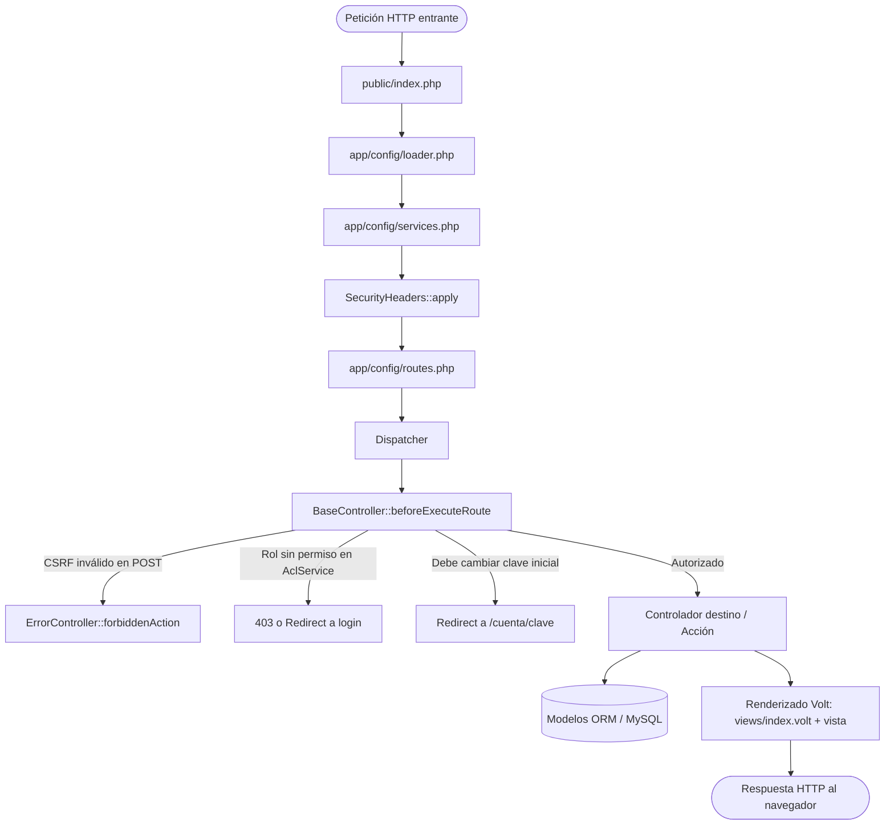
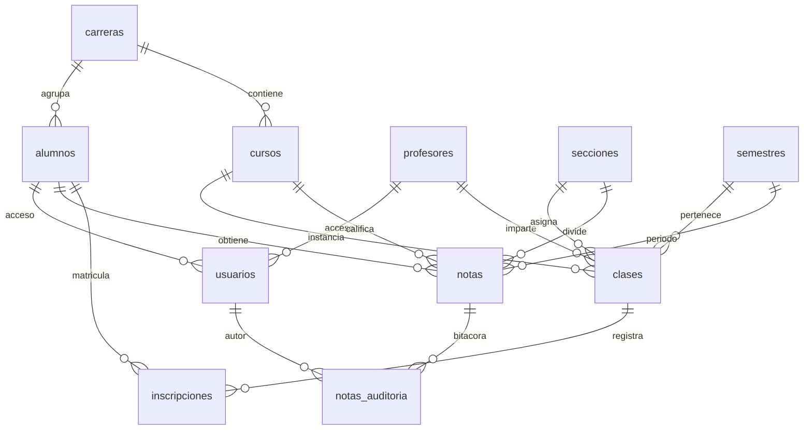

# 09 — Manual de Código y Arquitectura del Sistema

Este manual está diseñado para estudiar a profundidad la estructura, funcionamiento, decisiones de diseño y mecanismos de seguridad del **Sistema de Gestión Académica y Control Escolar**, desarrollado sobre **Phalcon 5 (PHP 8.2)** y **MySQL 8**.

---

## 1. Visión General y Stack Tecnológico

El sistema resuelve la administración escolar integral de nivel bachillerato:
- **Gestión de entidades**: Estudiantes, docentes, carreras, cursos, secciones y semestres.
- **Asignación académica**: Clases (relación curso-sección-semestre-profesor) e inscripciones de alumnos.
- **Control de calificaciones**: Captura en borrador, publicación oficial, edición con motivo obligatorio y bitácora de auditoría inmutable.
- **Reglas de negocio**: Bloqueo de semestres cerrados, nota mínima de aprobación (61 puntos), concurrencia segura.
- **Reportes descargables**: Exportación de reportes y boletas académicas a PDF (Dompdf) y CSV (UTF-8 con BOM).
- **Control de acceso basado en roles (RBAC)**: Portales y permisos diferenciados para Director, Docente y Estudiante.

### Componentes del Stack
| Capa | Tecnología / Herramienta | Función |
|---|---|---|
| **Lenguaje** | PHP 8.2 (tipado estricto, match expressions, nullsafe) | Motor de ejecución del backend |
| **Framework** | Phalcon 5 (extensión compilada en C) | Enrutador, Inyector de Dependencias (DI), ORM y Plantillas Volt |
| **Base de Datos** | MySQL 8 / MariaDB (Motor InnoDB) | Almacenamiento relacional, llaves foráneas y transacciones ACID |
| **Plantillas** | Phalcon Volt Template Engine | Renderizado del frontend con auto-escapado XSS (`|e`) |
| **PDF Engine** | `dompdf/dompdf` 3.x | Generación segura de reportes y boletas oficiales |
| **CSS/UI** | Bootstrap 5.3.3 + Bootstrap Icons 1.11 | Interfaz responsiva y accesible |
| **Pruebas** | PHPUnit 11 + Guzzle 7 | 161 pruebas de caja negra HTTP automatizadas |

---

## 2. Ciclo de Vida de una Petición (Request Lifecycle)

Cada petición HTTP que llega al servidor sigue este flujo determinista:



1. **Front Controller (`public/index.php`)**: Punto único de entrada. Carga configuración (`config.php`), registro de namespaces (`loader.php`) y servicios (`services.php`).
2. **Inyector de Dependencias (`app/config/services.php`)**: Registra la conexión a BD (`db`), el gestor de sesiones con cookies seguras (`session`), el enrutador (`router`), el motor de vistas (`view` con Volt), el servicio de seguridad (`security` para CSRF y hashes), y los servicios de dominio (`aclService`, `accesoService`, `exportService`).
3. **Cabeceras de Seguridad (`SecurityHeaders::apply`)**: Inyecta CSP (Content-Security-Policy), X-Frame-Options (`SAMEORIGIN`), X-Content-Type-Options (`nosniff`) y Referrer-Policy en cada respuesta.
4. **Enrutamiento Estricto (`app/config/routes.php`)**: Rutas mapeadas explícitamente por método HTTP (`addGet` para lecturas, `addPost` para mutaciones). Rutas inexistentes derivan a `ErrorController::notFoundAction()`.
5. **Filtro Pre-Ejecución (`BaseController::beforeExecuteRoute`)**:
   - Valida el token CSRF en cualquier petición POST (excepto `/logout` para permitir salir en cualquier momento).
   - Consulta el rol en sesión (o `invitado` por defecto).
   - Valida permisos contra [`AclService`](file:///C:/Users/jmolinac8/Desktop/proyecto-phalcon/proyecto-phalcon/app/library/Auth/AclService.php).
   - Si el usuario tiene activo el flag `debe_cambiar_clave`, restringe la navegación obligándolo a cambiar su contraseña en `/cuenta/clave`.

---

## 3. Modelo de Base de Datos y Relaciones

El esquema relacional (`database/schema.sql`) está normalizado en 3FN y garantiza integridad física mediante InnoDB:



### Tablas Principales:
- **`usuarios`**: Almacena credenciales de acceso.
  - Campos: `usuario`, `password_hash` (bcrypt costo 10), `rol` (`director`, `profesor`, `alumno`), `alumno_id` (FK NULL), `profesor_id` (FK NULL), `activo`, `debe_cambiar_clave`, `intentos_fallidos`, `bloqueado_hasta`.
- **`alumnos`**: Expediente del estudiante (`nombres`, `apellidos`, `fecha_nacimiento`, `foto`, `carrera_id`).
- **`profesores`**: Expediente docente (`nombres`, `apellidos`, `email`).
- **`clases`**: Asignación docente (`curso_id`, `seccion_id`, `semestre_id`, `profesor_id`). Posee restricción única `UNIQUE (curso_id, seccion_id, semestre_id)`.
- **`inscripciones`**: Matrícula del alumno en una clase específica (`alumno_id`, `clase_id`). Restricción `UNIQUE (alumno_id, clase_id)`.
- **`notas`**: Calificación obtenida.
  - Campos: `alumno_id`, `curso_id`, `semestre_id`, `seccion_id`, `nota` (`DECIMAL(5,2)` con `CHECK (nota >= 0 AND nota <= 100)`), `estado` (`borrador` o `publicada`), `publicada_at`, `updated_by`.
  - Restricción única: `UNIQUE (alumno_id, curso_id, semestre_id)` (un alumno no puede tener dos notas en el mismo curso y semestre).
- **`notas_auditoria`**: Bitácora inmutable de cambios (`nota_id`, `usuario_id`, `accion`, `nota_anterior`, `nota_nueva`, `motivo`, `created_at`).

---

## 4. Control de Acceso, Roles y Seguridad

### 4.1. Matriz de Roles y Permisos (ACL)
El archivo [`app/library/Auth/AclService.php`](file:///C:/Users/jmolinac8/Desktop/proyecto-phalcon/proyecto-phalcon/app/library/Auth/AclService.php) implementa `Phalcon\Acl\Adapter\Memory` con política por defecto `DENY`:

| Recurso / Módulo | Invitado | Alumno | Profesor | Director |
|---|:---:|:---:|:---:|:---:|
| Inicio (`/`) | Sí | Sí | Sí | Sí |
| Login / Logout | Sí | Sí | Sí | Sí |
| Cambiar contraseña propia | No | Sí | Sí | Sí |
| Portal Estudiante (`/mi/notas`, `/mi/perfil`) | No | Sí | No | Sí |
| Portal Docente (`/profesor/clases`) | No | No | Sí | Sí |
| Reportes (`/reportes/*`) | No | No | Sí | Sí |
| CRUD Catálogos (`carreras`, `cursos`, etc.) | No | No | No | Sí |
| Gestión de Alumnos / Profesores | No | No | No | Sí |
| Apertura / Cierre de Semestres | No | No | No | Sí |
| Bitácora de Auditoría (`/auditoria`) | No | No | No | Sí |

### 4.2. Prevención de IDOR (Insecure Direct Object Reference)
El ACL por controlador/acción no es suficiente: un alumno con rol `alumno` podría cambiar el ID en `/alumnos/5` y ver el expediente de otro estudiante.
- [`AccesoService::alumnoPuedeVerAlumno()`](file:///C:/Users/jmolinac8/Desktop/proyecto-phalcon/proyecto-phalcon/app/library/Auth/AccesoService.php): Valida que `$auth['alumno_id'] === $idSolicitado`. Si no coinciden, se retorna 404 (evitando fuga de existencia).
- [`AccesoService::profesorPuedeVerAlumno()`](file:///C:/Users/jmolinac8/Desktop/proyecto-phalcon/proyecto-phalcon/app/library/Auth/AccesoService.php): Valida mediante consulta SQL cruzada que el alumno esté inscrito en al menos una clase asignada a ese profesor.
- En [`ReporteService::historial()`](file:///C:/Users/jmolinac8/Desktop/proyecto-phalcon/proyecto-phalcon/app/library/Reportes/ReporteService.php#L58-L77), si el usuario actual es un alumno, la consulta añade obligatoriamente `AND n.estado = 'publicada'`, impidiendo que un alumno vea notas preliminares en borrador.

### 4.3. Autenticación Robusta y Protección contra Ataques
- **Prevención de Ataques de Tiempo (Timing Attacks)**: Si el usuario ingresado no existe en BD, [`AuthController::loginAction()`](file:///C:/Users/jmolinac8/Desktop/proyecto-phalcon/proyecto-phalcon/app/controllers/AuthController.php#L34-L39) ejecuta un hash ficticio con `password_verify()` para que la respuesta tarde el mismo tiempo y no se pueda enumerar usuarios válidos midiendo milisegundos.
- **Protección de Fuerza Bruta**: Conteo de `intentos_fallidos`. Al quinto intento erróneo, la cuenta se bloquea por 15 minutos (`bloqueado_hasta = date('Y-m-d H:i:s', time() + 900)`).
- **Anti-Fijación de Sesión**: Inmediatamente tras validar credenciales, se llama a `$this->session->regenerateId(true)` para destruir el identificador de sesión anterior y emitir una nueva cookie de sesión.

---

## 5. Lógica de Negocio y Reglas Críticas

### 5.1. Edición de Notas y Auditoría Obligatoria
Una nota publicada no puede modificarse en silencio. El flujo en [`NotasController::actualizarAction()`](file:///C:/Users/jmolinac8/Desktop/proyecto-phalcon/proyecto-phalcon/app/controllers/NotasController.php) exige:
1. **Motivo obligatorio**: Longitud mínima de 10 caracteres (`strlen($motivo) >= 10`).
2. **Control de Concurrencia (Bloqueo Pesimista)**:
   ```php
   $this->db->begin();
   // Bloquea la fila en MySQL impidiendo lecturas/escrituras sucias concurrentes
   $row = $this->db->fetchOne(
       "SELECT * FROM notas WHERE id = :id FOR UPDATE",
       \Phalcon\Db\Enum::FETCH_ASSOC,
       ['id' => $id]
   );
   ```
3. **Registro Inmutable**: Si el valor de la nota cambia, se crea un registro en `notas_auditoria` con `nota_anterior`, `nota_nueva`, `motivo`, `usuario_id` y `created_at`.
4. **Commit Atómico**: Todo ocurre dentro de una transacción. Si falla el guardado de la nota o de la auditoría, se hace `$this->db->rollback()`.

### 5.2. Regla de Semestres Cerrados
- En [`Semestre.php`](file:///C:/Users/jmolinac8/Desktop/proyecto-phalcon/proyecto-phalcon/app/models/Semestre.php), un semestre con `cerrado = 1` representa un ciclo académico concluido.
- **Regla**: No se pueden crear nuevas notas ni editar notas existentes asociadas a un semestre cerrado.
- **Excepción**: Únicamente el usuario con rol `director` tiene la potestad de reabrir el semestre formalmente (`/catalogos/semestres/{id}/reabrir`).

### 5.3. Generación y Exportación Segura de Reportes
El servicio [`ExportService`](file:///C:/Users/jmolinac8/Desktop/proyecto-phalcon/proyecto-phalcon/app/library/Reportes/ExportService.php) implementa las mejores prácticas para descargas:
- **PDF (Dompdf)**:
  - `isRemoteEnabled = false` (evita ataques SSRF al impedir que el generador haga peticiones hacia servidores externos).
  - `isPhpEnabled = false` (impide ejecución de código arbitrario incrustado).
  - `chroot = BASE_PATH . '/public'` (restringe la lectura de assets únicamente a imágenes locales de `public/`).
- **CSV**:
  - Inicia con el Byte Order Mark UTF-8 (`\xEF\xBB\xBF`) para que Microsoft Excel en español reconozca tildes y caracteres `ñ` automáticamente sin desconfigurar la codificación.
  - Sanitiza cada celda contra *CSV Formula Injection* (si un texto inicia con `=`, `+`, `-` o `@`, le antepone una comilla simple `'`).

---

## 6. Organización de Vistas (Volt Template Engine)

Las vistas están estructuradas bajo el principio DRY (Don't Repeat Yourself):
- **`app/views/index.volt`**: Layout maestro global. Contiene el `<head>`, enlaces a Bootstrap por CDN, menú de navegación contextual por rol, alertas flash (`{{ flashSession.output() }}`) y el contenedor principal (`{{ content() }}`).
- **`app/views/index/index.volt`**: Tablero inicial que adapta las tarjetas visibles dependiendo de si el usuario es Director, Docente, Alumno o Invitado.
- **Escape Obligatorio**: Cada variable impresa en pantalla utiliza el filtro `|e` (ej. `{{ alumno.nombres|e }}`). El script de auditoría verifica que ninguna expresión quede sin escapar para garantizar inmunidad contra XSS (Cross-Site Scripting).

---

## 7. Pruebas Automatizadas y Auditoría de Código

### 7.1. Pruebas de Caja Negra (`HttpTestCase`)
Las pruebas en `tests/Feature/` no simulan llamadas internas a clases, sino que realizan peticiones HTTP reales mediante Guzzle contra un servidor de pruebas dedicado (`127.0.0.1:8081` conectado a la base `escuela_test`).
- **161 pruebas automatizadas** cubren:
  - Autenticación, bloqueo por fuerza bruta y reseteo de contraseña.
  - Navegación, redirecciones y prevención de interferencia de sesión entre roles.
  - Protección IDOR en alumnos y profesores.
  - Transacciones de edición de notas, motivos obligatorios y auditoría.
  - Respeto a semestres cerrados.
  - Generación de archivos PDF y CSV válidos.
- **Ejecución**:
  ```bash
  vendor/bin/phpunit
  ```

### 7.2. Script de Auditoría Estricta (`scripts/auditoria.sh`)
Script bash que audita estáticamente el código fuente en busca de vulnerabilidades comunes:
1. Expresiones Volt `{{ }}` sin `|e`.
2. Uso de superglobales directas (`$_GET`, `$_POST`, `$_SESSION`) en vez de `$this->request` o `$this->session`.
3. Concatenación de variables en consultas SQL (exige uso de parámetros enlazados `:bind:`).
4. Asignación masiva sin lista blanca en `$modelo->assign()`.
5. Formularios POST sin token CSRF.
6. Rutas que modifican datos sin verbo POST.

---

## 8. Guía de Preguntas Frecuentes para Examen / Defensa Técnica

### P1: ¿Por qué eligieron Phalcon en lugar de Laravel o Symfony?
> **Respuesta**: *Phalcon es un framework MVC implementado como una extensión de C para PHP. A diferencia de los frameworks tradicionales basados en archivos que deben ser leídos, analizados y compilados en cada petición, Phalcon reside permanentemente en memoria RAM. Esto reduce el consumo de CPU y memoria en un 60-80%, ofreciendo un rendimiento muy superior en entornos escolares concurrentes, manteniendo al mismo tiempo una arquitectura MVC limpia y estructurada.*

### P2: ¿Cómo evitan que un alumno vea las notas o datos de otro alumno (IDOR)?
> **Respuesta**: *No confiamos únicamente en el rol del usuario en el ACL. En `AlumnosController::verAction()` invocamos a `AccesoService::alumnoPuedeVerAlumno()`, el cual valida a nivel de fila que el ID solicitado en la URL coincida estrictamente con el `alumno_id` almacenado en la sesión autenticada. Si no coinciden, se responde con un código 404 No Encontrado para no revelar la existencia del expediente a terceros.*

### P3: ¿Cómo manejan la concurrencia cuando dos profesores intentan calificar o editar al mismo alumno simultáneamente?
> **Respuesta**: *Utilizamos bloqueo pesimista en la base de datos (`SELECT ... FOR UPDATE`) dentro de una transacción gestionada por InnoDB. Cuando una transacción solicita el registro de la nota para edición, la fila queda bloqueada a nivel de base de datos; cualquier otra petición concurrente debe esperar a que la primera transacción complete su `COMMIT` o `ROLLBACK`, evitando condiciones de carrera (Race Conditions) y pérdidas de datos.*

### P4: ¿Por qué el cierre de semestre bloquea las notas y cómo se implementa?
> **Respuesta**: *Es una regla de negocio fundamental: una vez finalizado el periodo escolar y cerrado el ciclo, las actas no deben sufrir alteraciones. En el controlador y en las validaciones del modelo verificamos la bandera `cerrado` de la tabla `semestres`. Si es verdadera, se rechaza cualquier inserción o actualización de notas. Solo el Director puede reabrir un semestre si existe una justificación administrativa.*

### P5: ¿Qué medidas de seguridad se implementaron para la generación de reportes en PDF?
> **Respuesta**: *Configuramos Dompdf de forma restrictiva: desactivamos `isRemoteEnabled` para prevenir ataques SSRF (Server-Side Request Forgery), deshabilitamos la ejecución de PHP embebido (`isPhpEnabled = false`) y restringimos el sistema de archivos mediante `chroot` para que solo tenga acceso a los recursos estáticos de `public/`. Además, el nombre del archivo descargado es generado estáticamente por el servidor para evitar Directory Traversal.*
