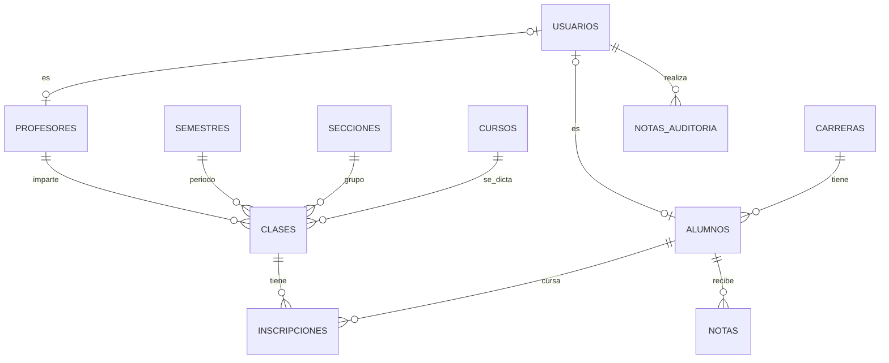

# 10 — Plan: reportes descargables, login, roles y edición de notas

## 0. Resumen y advertencia de alcance
Lo que se pide es grande: **exportar reportes, login, 3 roles, edición de notas publicadas, relaciones más completas**. Quedan pocos días para la entrega (16/Oct) y la rúbrica pone **9 de 20 puntos en que todo lo requerido funcione**. Por eso el plan se ordena así:

1. **Primero lo que el enunciado ya pide** (reportes que generan archivo). Es lo único de esta lista que cuenta directamente en la nota.
2. Después lo que agrega valor (login, roles, edición con auditoría), **por etapas que siempre dejan el sistema entregable**.
3. Lo que no alcance se documenta como "trabajo futuro" en el PDF (también suma).

**Antes de tocar nada:** `git tag v1-estable` y trabajar en una rama (`git checkout -b roles`). Si algo se complica el último día, se entrega `v1-estable`.

## 1. Decisiones de diseño (recomendadas)
| Tema | Decisión | Por qué |
|---|---|---|
| Esquema | **Cambio incremental**: se mantiene `notas` (alumno, curso, semestre, sección) y se agregan `profesores`, `usuarios`, `clases`, `inscripciones`, `notas_auditoria` | No rompe las 87 pruebas ni los reportes actuales. El modelo "perfecto" (notas colgadas de la inscripción) queda como mejora futura. |
| Login | Sesión con tabla `usuarios` (reemplaza el Basic Auth) | Necesario para roles y auditoría |
| Permisos | `Phalcon\Acl\Adapter\Memory` (rol → controlador/acción) **+** verificación por fila (pertenencia) | El ACL por rol no basta: sin la verificación por fila un alumno puede ver notas de otro cambiando el número en la URL (IDOR) |
| Edición de notas | Estado `borrador/publicada`, motivo obligatorio al corregir, auditoría, cierre de semestre | Una nota publicada no se cambia en silencio |
| PDF | `dompdf/dompdf` (Composer) + CSV nativo | Phalcon no trae generador de PDF |

## 2. Reportes descargables (Etapa 1, requisito del enunciado)

### 2.1 Qué se genera
| Reporte del enunciado | Pantalla | Archivos |
|---|---|---|
| a. General de alumnos por carrera | `/reportes/alumnos-por-carrera` | **PDF** + CSV |
| b. Notas por carrera, curso y sección | `/reportes/notas?carrera_id=&curso_id=&seccion_id=` | **PDF** + CSV (respetando los filtros activos) |
| c. Consulta de alumno + historial de notas | `/alumnos/{id}` | **PDF "Ficha del alumno"** (datos, foto, historial, promedio, aprobados/reprobados) |

Cada pantalla tiene botones "Descargar PDF" y "Descargar CSV" que usan los mismos filtros.

### 2.2 Rutas
```
GET /reportes/alumnos-por-carrera?carrera_id=&formato=pdf|csv
GET /reportes/notas?carrera_id=&curso_id=&seccion_id=&formato=pdf|csv
GET /alumnos/{id}/ficha?formato=pdf
```
`formato` solo acepta `pdf` o `csv` (lista blanca); otro valor → 404. Son GET porque solo leen datos.

### 2.3 Contenido de los PDF
Encabezado con nombre de la escuela, título, **filtros aplicados**, fecha/hora y usuario que lo generó; tabla con encabezado repetido en cada página; totales (cantidad de alumnos, promedio, aprobados/reprobados con el umbral 61); numeración "Página X de Y". Orientación horizontal para el reporte de notas. Ficha: foto, datos personales, tabla de historial por semestre, promedio general.

### 2.4 Implementación
```bash
composer require dompdf/dompdf          # última 3.x  (única dependencia de ejecución)
composer install --no-dev --optimize-autoloader   # para el ZIP final
```
En `public/index.php`: `if (is_file(BASE_PATH.'/vendor/autoload.php')) require BASE_PATH.'/vendor/autoload.php';`

Archivos nuevos:
- `app/library/Reportes/ExportService.php` con `csv(array $filas, array $columnas, string $nombre)` y `pdf(string $html, string $nombre, string $orientacion)`; ambos devuelven un `Phalcon\Http\Response`.
- Plantillas HTML para PDF en `app/views/reportes/pdf/` (Volt, con `|e` en todo dato) renderizadas a texto.
- `ReporteService` ya devuelve arreglos: la pantalla, el PDF y el CSV usan **la misma consulta** (así nunca difieren).

Configuración segura de dompdf (obligatoria):
```php
$opts = new \Dompdf\Options();
$opts->set('isRemoteEnabled', false);     // no descarga recursos externos (evita SSRF)
$opts->set('isPhpEnabled', false);        // no ejecuta PHP embebido
$opts->set('chroot', BASE_PATH . '/public'); // solo puede leer imágenes de public/
$opts->set('defaultFont', 'DejaVu Sans'); // acentos y ñ
$pdf = new \Dompdf\Dompdf($opts);
$pdf->loadHtml($html, 'UTF-8');
$pdf->setPaper('letter', 'landscape');
$pdf->render();
```
Respuesta: `Content-Type: application/pdf`, `Content-Disposition: attachment; filename="reporte-notas-2026-10-15.pdf"` con **nombre fijo generado por el servidor** (nunca con texto del usuario).

CSV: UTF-8 con BOM (`"\xEF\xBB\xBF"`), separador `;` (Excel en español), generado con `fputcsv`. **Protección contra inyección de fórmulas:** si una celda empieza con `=`, `+`, `-`, `@`, tab o retorno, anteponer `'`.

Alternativa sin dependencias (plan B si dompdf da problemas): vista imprimible con `@media print` y botón "Imprimir / Guardar como PDF". El botón debe usar un script externo (`public/js/imprimir.js`), porque la CSP bloquea `onclick` inline.

### 2.5 Seguridad y rendimiento de los exportes
- Los mismos permisos que la pantalla (ver sección 4): el profesor exporta solo sus clases; el alumno solo su ficha.
- **Tope de filas** (por ejemplo 2000) y mensaje "refine los filtros": dompdf es lento y consume memoria con miles de filas; sin tope es una vía de denegación de servicio.
- Escapar todo dato en las plantillas: HTML inyectado en un nombre (``) no debe disparar peticiones ni romper el PDF.
- No guardar los PDF en disco (se generan y se envían); si se guardan, fuera de `public/`.

### 2.6 Pruebas de los exportes
- PDF: 200, `Content-Type: application/pdf`, cuerpo empieza con `%PDF-`, tamaño > 1 KB, `Content-Disposition` con nombre fijo.
- CSV: BOM, separador `;`, encabezados, contiene solo lo filtrado; una celda `=HYPERLINK(...)` sale con `'` delante.
- `formato=exe`, `formato[]=pdf`, `formato=pdf%0d%0aX:y` → 404/400, sin 500 y sin cabeceras inyectadas.
- Nombre con `` → el PDF se genera rápido (sin esperar red).
- 3000 alumnos → responde con el tope (o rechaza), sin superar el tiempo/memoria.

## 3. Modelo de datos mejorado

- **clase** = curso + sección + semestre + profesor (única por esa combinación).
- **inscripción** = alumno en una clase (define quiénes son "los estudiantes del profesor").
- La **nota** sigue identificada por alumno + curso + semestre + sección; pertenece a la clase que coincide con esos tres datos.
- SQL completo y migración de los datos existentes: `database/002_roles_y_clases.sql` (los datos actuales se convierten en clases e inscripciones automáticamente).
- Al pasar esto a `database/schema.sql` respeta el orden de creación: carreras, cursos, secciones, semestres, profesores, alumnos, usuarios, clases, inscripciones, notas, notas_auditoria. Así `php cli/reset_db.php` y las pruebas siguen funcionando.
- Usuarios de demo: **no** poner contraseñas en `seed.sql`. Crear `cli/seed_usuarios.php` que genera los hashes con `password_hash()` (director, 2 profesores, un usuario por alumno de demo) y toma las claves de demo de variables de entorno o las imprime una vez.

## 4. Roles y permisos
### 4.1 Matriz por rol
| Función | Director | Profesor | Alumno |
|---|---|---|---|
| Catálogos (carreras, cursos, secciones, semestres) | Total | — | — |
| Alumnos (crear/editar/eliminar) | Total | — | — |
| Ver ficha de alumno | Todos | Solo alumnos inscritos en sus clases (lectura) | Solo la propia |
| Profesores, usuarios, clases, inscripciones | Total | — | — |
| Ingresar notas | Todas | Solo en sus clases (semestre abierto) | — |
| Editar nota publicada | Siempre (con motivo) | Solo sus clases, semestre abierto, con motivo | — |
| Ver notas | Todas | Las de sus clases | Solo las propias **publicadas** |
| Reportes y exportes | Todos | Solo de sus clases/estudiantes | Solo su boleta/ficha |
| Cerrar semestre, ver auditoría | Sí | — | — |
| Cambiar su contraseña | Sí | Sí | Sí |

### 4.2 Dos capas de control (las dos son obligatorias)
1. **Por rol (ACL):** `Phalcon\Acl\Adapter\Memory`, acción por defecto *denegar*; componentes = controladores, acciones = métodos. Se consulta en `BaseController::beforeExecuteRoute` para todas las rutas.
2. **Por fila (pertenencia):** `AccesoService` decide si *este* usuario puede tocar *este* registro. **Nunca** buscar un registro solo por id: la consulta ya lleva el filtro de pertenencia.

Si no hay pertenencia, responder **404** (no 403) para no revelar que el registro existe. El `alumno_id`/`profesor_id` sale de la **sesión del servidor**, nunca de un campo del formulario ni de la URL.

## 5. Login y sesiones
- Tabla `usuarios`, claves con `password_hash()`/`password_verify()`; mínimo 8 caracteres.
- Mensaje genérico "Usuario o contraseña incorrectos"; si el usuario no existe, igual se ejecuta una verificación de hash (misma duración, no revela si existe).
- **Bloqueo por intentos:** 5 fallos → bloqueo de 15 min (`intentos_fallidos`, `bloqueado_hasta`).
- Al iniciar sesión: regenerar el id de sesión (`$this->session->regenerateId(true)`) para evitar fijación.
- Cerrar sesión por **POST** con token CSRF. Expiración por inactividad (por ejemplo 30 min).
- Primera vez: `debe_cambiar_clave = 1` obliga a cambiarla. Claves iniciales aleatorias, nunca el carné ni la fecha de nacimiento.
- `/login` es la única ruta pública. Todo lo demás redirige a `/login` si no hay sesión. Con HTTPS: `session.cookie_secure=1`.
- Se elimina el Basic Auth de `BaseController` (o se deja apagado).
- `ultimo_acceso` actualizado; usuarios `activo = 0` no pueden entrar.

## 6. Edición de notas ya publicadas
**Flujo**
1. El profesor guarda notas en **borrador** (el alumno no las ve) y las **publica** (`estado = 'publicada'`, `publicada_at`).
2. Corregir una publicada: formulario con la nota nueva y **motivo obligatorio** (mínimo 10 caracteres).
3. En **una transacción**: actualizar la nota (`updated_by`) e insertar en `notas_auditoria` (anterior, nueva, motivo, usuario, fecha).
4. Semestre **cerrado** (`semestres.cerrado = 1`): solo el director puede corregir.
5. **Bloqueo optimista:** el formulario lleva `updated_at` oculto; si cambió mientras editaban, se rechaza con "la nota fue modificada, recarga" (evita pisar cambios).
6. La ficha muestra una marca "corregida" y el director ve el historial completo de cada nota.
7. Validaciones iguales a las de crear: 0–100, número, existe la clase, pertenencia.

## 7. Vistas por rol
**Comunes:** `/login`, `/logout` (POST), `/cuenta/clave`, páginas 403/404. Menú distinto por rol; mostrar solo lo permitido (pero la seguridad la da el servidor, no el menú).

## 8. Pruebas (actualizar y ampliar)
1. **Actualizar `HttpTestCase`:** helper `loginComo('director'|'profesor'|'alumno')`. En `setUp`, iniciar sesión como director para que las pruebas existentes sigan valiendo.
2. **Autenticación:** pruebas de login/logout/bloqueo.
3. **Matriz de roles** (parametrizada).
4. **IDOR (lo más importante):** pruebas de aislamiento estricto por pertenencia.
5. **Edición de notas:** pruebas de motivo, auditoría, semestre cerrado, bloqueo optimista.
6. **Exportes:** pruebas de PDF, CSV y sanitización contra inyección de fórmulas.
7. **Actualizar `AtaquesTest`:** pruebas por rol y escalada de privilegios.

## 9. Plan por etapas (cada una deja el sistema entregable)
| Etapa | Qué | Meta |
|---|---|---|
| **0** | `git tag v1-estable`, rama `roles` | Hecho |
| **1** (Día 1) | Exportes PDF/CSV de los 3 reportes + pruebas | Cumple el enunciado completo |
| **2** (Día 2) | Migración 002, login/logout, ACL, `BaseController` nuevo, director = lo actual; actualizar pruebas | Sistema con login |
| **3** (Día 3) | Edición de notas con motivo + auditoría + semestre cerrado (director); rol **alumno** (mis notas, boleta PDF); pruebas IDOR | Edición + alumno |
| **4** (Día 4) | Rol **profesor** (clases, inscripciones, ingreso/publicación de notas); `AtaquesTest` por rol; `bash scripts/auditoria.sh` | Profesor |
| **5** (Viernes 16) | Congelar: PDF del documento, ZIP, ensayo desde cero. **Sin funciones nuevas** | Entrega |
